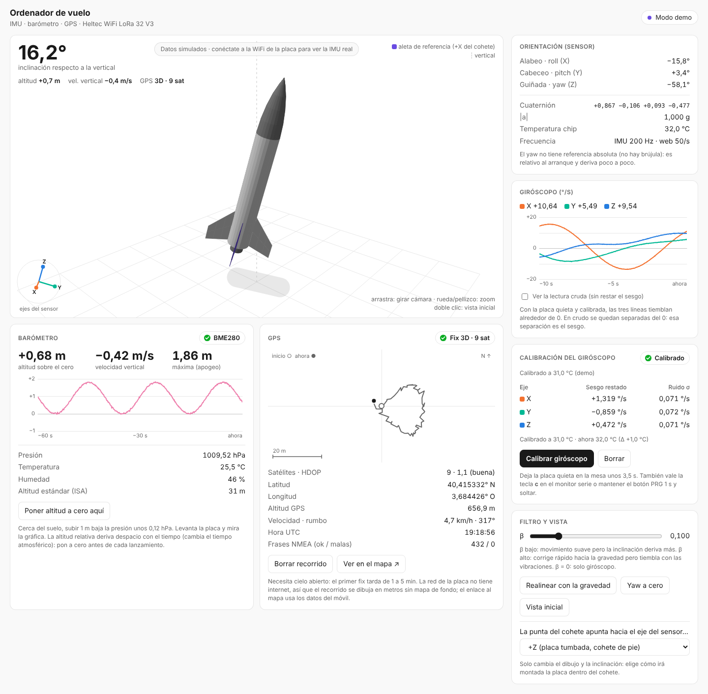
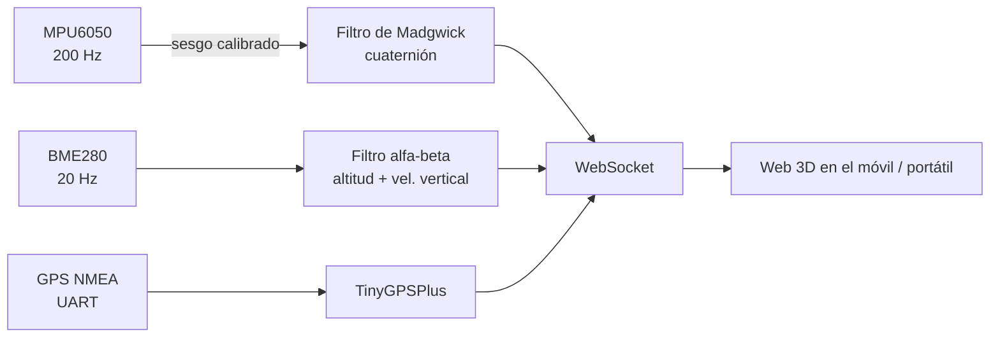

# Ordenador de vuelo · IMU + barómetro + GPS con web 3D en directo

> **EN:** Model-rocket flight computer on a Heltec WiFi LoRa 32 V3 (ESP32-S3) with a custom sensor PCB
> (MPU6050, BME280, GPS). Calibrated gyro + Madgwick attitude filter at 200 Hz, barometric altitude and
> vertical speed, GPS, all streamed over WebSocket to a live 3D web dashboard served by the board itself.



La placa crea su propia red WiFi y sirve una web donde se ve en tiempo real la orientación del cohete
en 3D, la altitud, la velocidad vertical y la posición GPS. No necesita internet: funciona igual en el
campo de lanzamiento.

## Qué hace

- **IMU a 200 Hz** (MPU6050, driver propio por registros): calibración del giróscopo con control de
  quietud, guardada en flash, y fusión giróscopo + acelerómetro con un **filtro de Madgwick**
  (orientación en cuaternión, sin bloqueo de cardán al apuntar en vertical).
- **Rechazo del acelerómetro** cuando no mide solo la gravedad (|a| ≠ 1 g, p. ej. con el motor
  encendido): en ese momento se integra solo el giróscopo.
- **Barómetro a 20 Hz** (BME280 o BMP280, detección automática): altitud relativa, velocidad vertical
  con un **filtro alfa-beta** y altitud máxima (apogeo).
- **GPS** (NMEA por UART): fix, satélites, HDOP, posición, velocidad, rumbo y hora UTC.
- **Web servida por el propio ESP32** por WebSocket (orientación a 50 Hz): cohete 3D dibujado a mano
  en `<canvas>` (sin librerías externas), gráficas en directo, recorrido GPS en metros, calibración y
  ajuste del filtro desde el navegador. Incluye un **modo demo** con datos simulados.



## Hardware

- Heltec WiFi LoRa 32 V3 (ESP32-S3 + SX1262)
- PCB de sensores propia: MPU6050, BME280 y GPS (NEO-6M / NEO-M8N / ATGM336H a 9600 baudios)

## Conexiones

| Señal | Heltec V3 |
|---|---|
| SDA (MPU6050 + BME280) | GPIO 41 |
| SCL (MPU6050 + BME280) | GPIO 42 |
| TX del GPS → | GPIO 47 (RX de la placa) |
| RX del GPS ← | GPIO 48 (TX de la placa) |

GPS a 9600 baudios (los de fábrica de NEO-6M / NEO-M8N / ATGM336H).
El barómetro se detecta solo en 0x76 o 0x77 y se pregunta qué chip es (0x60 BME280, 0x58 BMP280).

Bus de sensores en `Wire1`, igual que en el transmisor de [telemetria-868](https://github.com/alejandrommberna/telemetria-868) (el 17/18 es el bus
interno de la OLED y no sale a los pines). Al arrancar, el monitor serie lista lo que encuentra en
el bus (0x68 = MPU6050, 0x76 = BME280) y el WHO_AM_I del MPU (0x68 original, 0x70 MPU6500...).
El MPU se maneja directamente con sus registros, así que también funcionan los clones compatibles.

## Compilar y subir (PlatformIO)

1. Clona el repositorio y abre la carpeta en VS Code con PlatformIO.
2. **Upload** (flecha →). Las librerías se descargan solas.
3. **Monitor** (115200 baudios): verás la IP y una línea por segundo con los ángulos.

La página `web/index.html` se mete dentro del firmware al compilar (`board_build.embed_txtfiles`):
no hace falta subir ningún sistema de archivos. Si editas el HTML, vuelve a compilar y subir.

## Uso

1. Conéctate a la WiFi **OrdenadorVuelo** (clave `cohete1234`, se cambia en `src/config.h`).
2. Abre **http://192.168.4.1** (o http://vuelo.local).
3. Placa quieta sobre la mesa → **Calibrar giróscopo** (unos 3,5 s).

Otras formas de calibrar: tecla `c` en el monitor serie, o mantener pulsado **PRG** 1 s y soltar.
El LED blanco se enciende mientras calibra. La calibración se guarda en la flash (NVS) y se carga
al encender. La altitud se pone a cero sola al arrancar y con el botón **Poner altitud a cero aquí**.
Teclas del monitor serie: `c` calibrar, `b` borrar calibración, `r` realinear, `z` altitud a cero.

**Modo demo:** abre `web/index.html` con doble clic en el ordenador. Simula la placa (giróscopo con
sesgo, barómetro con ruido y un paseo GPS) con los mismos filtros que el firmware.

## Estructura

```
src/config.h       pines, rangos, umbrales, WiFi        ← lo que se toca
src/imu.*          driver del MPU6050 por registros + calibración + guardado en flash
src/madgwick.*     fusión giróscopo + acelerómetro → cuaternión
src/baro.*         BME280/BMP280: presión → altitud, velocidad vertical (alfa-beta), apogeo
src/gps.*          GPS por UART con TinyGPSPlus
src/web.*          punto de acceso WiFi, servidor web y WebSocket
src/main.cpp       el bucle: 200 Hz IMU, 20 Hz barómetro, GPS continuo, envíos a la web
web/index.html     la página (3D hecho a mano en canvas, sin internet)
```

## Protocolo del WebSocket (`/ws`)

Placa → navegador, 50 Hz:
`{"t":"d","q":[w,x,y,z],"g":[gx,gy,gz],"a":[ax,ay,az],"T":°C,"hz":200,"cp":-1,"ac":1}`
(`g` en °/s ya corregido, `a` en g, `cp` progreso de calibración 0..1 o −1, `ac` = se usó la gravedad)

Placa → navegador, cuando cambia la calibración:
`{"t":"c","estado":"ok|midiendo|fallo|sin","tiene":1,"b":[sesgo],"s":[ruido σ],"Tc":°C,"beta":0.1,"msg":"..."}`

Placa → navegador, 10 Hz:
`{"t":"b","chip":"BME280","p":hPa,"T":°C,"hr":%,"h":m,"vz":m/s,"hmax":m,"hisa":m}` (`hr` = −1 con BMP280)

Placa → navegador, 1 Hz o con cada posición nueva:
`{"t":"g","mudo":0,"fix":3,"sat":9,"hdop":1.1,"lat":..,"lon":..,"alt":m,"vel":km/h,"rumbo":°,"hora":"hh:mm:ss","ok":n,"mal":n}`

Navegador → placa: `cal`, `borrar`, `realinear`, `beta=0.05`, `cero`

## Siguientes fases

- Fusionar barómetro + acelerómetro (Kalman) para una velocidad vertical rápida y limpia.
- Registro en flash a alta frecuencia + máquina de estados de vuelo (rampa, motor, apogeo, paracaídas).
- Telemetría por el SX1262 hacia la estación de tierra.
